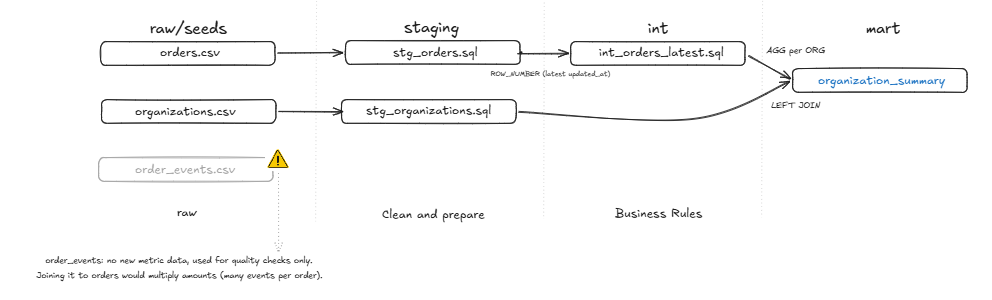
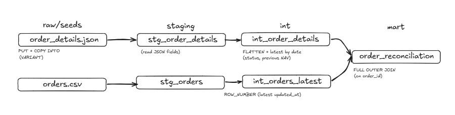
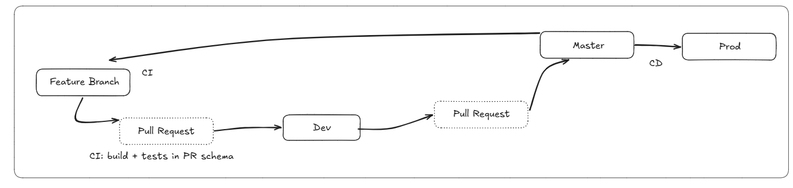

# dbt Snowflake Analytics

I built this with dbt on Snowflake. The source files are loaded into `RAW`, typed in `STAGING`, transformed in `INTERMEDIATE` and exposed in `MART`. Each task links to its code and shows the result I got.

## Task 1: Organization Summary

Model: [`organization_summary`](src/dbt/models/mart/organization_summary.sql)



First I keep only the latest version of each order, using `ROW_NUMBER` ordered by `updated_at`. This also removes the duplicated order 1010. Then I aggregate the orders per organization and only after that join with the organizations, so the join is one to one and nothing gets counted twice. The join starts from organizations, so organization 9 shows up even without orders.

| org | name | orders | completed | completed amount | latest order | latest completed |
|---|---|---|---|---|---|---|
| 1 | Alpha Advisors | 3 | 3 | 49,000 | 2026-07-25 09:00 | 2026-07-25 08:30 |
| 2 | Beacon Capital | 3 | 1 | 21,000 | 2026-07-26 09:00 | 2026-07-26 10:00 |
| 3 | Cedar Partners | 2 | 2 | 48,000 | 2026-07-09 09:20 | 2026-07-10 16:00 |
| 4 | Delta Wealth | 2 | 2 | 22,000 | 2026-07-12 11:00 | 2026-07-12 12:00 |
| 5 | Northstar Capital | 2 | 2 | 62,000 | 2026-07-15 10:00 | 2026-08-01 08:00 |
| 6 | Northstar Capital | 2 | 2 | 33,000 | 2026-07-17 10:00 | 2026-07-17 12:00 |
| 7 | Oak Ridge Advisors | 2 | 1 | 27,000 | 2026-07-20 09:00 | 2026-07-18 12:00 |
| 8 | Summit Partners | 2 | 1 | 45,000 | 2026-07-24 10:00 | 2026-07-21 14:00 |
| 9 | Westbridge Capital | 0 | 0 | 0 | | |

Assumptions:
- 1004 was completed and then cancelled, so it doesn't count as completed.
- `complete` in 1008 is a typo, so I treat it as `completed`.
- 1007 has an amount of -5,000. It could be a redemption, but there's no order type to confirm it, and 1012 has no amount at all. Both count as completed orders, but I left their amounts out of the total. Instead of guessing, they're counted in `orders_with_invalid_amount`.
- Orgs 5 and 6 have the same name but different ids, so I kept them separate.
- 1016 points to org 999, which doesn't exist, and 1017 has no org, so neither can be assigned.
- I didn't use `order_events` for the metrics. It has no amounts, and joining it with orders would multiply them because each order has several events.

## Task 2: JSON / Semi-Structured Data

Models: [`int_order_details`](src/dbt/models/intermediate/int_order_details.sql) and [`order_reconciliation`](src/dbt/models/mart/order_reconciliation.sql)



The JSON is loaded into Snowflake as it is and parsed with SQL. The status history and NAV history are sorted by their dates instead of their position in the array, because in 1009 both arrays come out of order. I left `nav_change` empty for 1004, since a cancelled order isn't a loss.

| order | status | current nav | previous nav | nav change |
|---|---|---|---|---|
| 1001 | completed | 10,450.25 | 10,120.50 | 329.75 |
| 1002 | completed | 25,780.10 | 25,150.00 | 630.10 |
| 1004 | cancelled | 0.00 | 40,500.00 | |
| 1006 | completed | 31,520.75 | 30,200.00 | 1,320.75 |
| 1009 | completed | 52,650.40 | 50,800.00 | 1,850.40 |
| 1012 | completed | | | |
| 1013 | completed | 28,110.35 | 27,250.00 | 860.35 |
| 1015 | completed | 46,125.00 | 45,400.00 | 725.00 |

What doesn't match between the JSON and `orders`:
- Only 8 of the 20 orders are in the JSON.
- For those 8, the organization, amount and final status are the same in both.
- `orders` is missing some status steps that the JSON has, like `approved` in 1006 and 1009.

How I'd handle:
- Missing attributes stay `NULL`. I don't fill them with a default value.
- Unexpected types go through `TRY_TO_NUMBER`, so a number sent as text still works, like the NAV in 1013.
- New fields aren't lost because the raw JSON is kept, and a test warns when a new key shows up.
- If a field is renamed or removed, it turns into `NULL` and the tests fail.

## Task 3: Data Quality

| Check | What it catches | Found | If it fails |
|---|---|---|---|
| [`assert_no_duplicate_order_records`](src/dbt/tests/assert_no_duplicate_order_records.sql) | the same order record sent twice | 1010 | warn. Duplicates are removed later, but the extraction should be checked |
| [`assert_order_updated_after_created`](src/dbt/tests/assert_order_updated_after_created.sql) | an order updated before it was created | 1019 | warn. The latest version depends on `updated_at`, so the source clock needs a look |
| [`positive_values`](src/dbt/tests/generic/positive_values.sql) on `orders.amount` | negative or zero amounts | 1007 | warn. The amount stays out of the totals until the source fixes it |
| [`assert_order_details_json_structure`](src/dbt/tests/assert_order_details_json_structure.sql) | missing fields, wrong types or new keys in the JSON | 1012, 1013 | warn. Values stay `NULL`, and a spike means the JSON changed |

Problems that come from the source only warn, so one bad record doesn't stop the pipeline. Checks on my own models, like one row per order and per organization, fail the build.

## Task 4: Pipeline Design & Debugging

### Incremental processing
Airbyte would sync incrementally using `updated_at` as the cursor and append every change to the raw tables with a load timestamp. Raw is never overwritten.

The dbt models would be incremental and use `MERGE` on `order_id`. New orders get inserted, changed ones get updated, and each run only reprocesses the orders that got new rows. A lookback of a few days catches records that arrive late, and duplicates are removed inside each batch before the merge.

The watermark comes from the target table itself. If a run fails, it doesn't move, so the next run starts from the same point. Since the merge works by key, running the same batch twice gives the same result.

### Debugging $10M to $27M
Going from $10M to $27M when only about $1M was expected looks like duplicated data, not new data. This is how I'd look for it:

1. Check what changed since yesterday: deploys, Airbyte settings, the source schema or a backfill.
2. Rule out both ends. Does the dashboard match the mart? Does the source system show around $11M?
3. Compare row counts and totals in each layer, from raw to mart, and find where the number jumps. Usually it's a sync that reloaded everything and appended it, or a join that multiplied rows.
4. Use Time Travel to compare today's tables with yesterday's and find which orders explain the extra $16M.

The pipelines said they succeeded because nothing crashed. A `unique` test on `order_id` and an alert on big day over day changes would have caught it.

## Task 5: Production Application

Once customers see the data, showing a wrong number is worse than showing an old one.

- Tests run before anything is published, and the totals are reconciled with the source. If data is incomplete, it's flagged, like `orders_with_invalid_amount`, instead of hidden.
- Each run builds a separate copy and only replaces the live tables when all tests pass. If a run fails, the app keeps showing the last good version.
- Freshness has an agreed limit, checked with `dbt source freshness`, and the app shows when the data was last updated.
- Alerts go out for failed runs, test warnings, late sources and unusual changes in volume or totals, and someone is on call for them.
- The app reads from stable views with a dbt model contract. Changes should only add columns. Anything that breaks the current schema goes into a new model version, so the app has time to migrate.

## How to run

```sh
cd src/dbt
dbt seed                               # load the CSV files into RAW
dbt run-operation load_order_details   # load the JSON into RAW
dbt build                              # models and tests
```

The connection uses environment variables. See [`.env.example`](.env.example) and [`profiles.yml`](src/dbt/profiles.yml).

## Extras

This part isn't required by the case. It's how I usually set up a project.

<details>
<summary>Project layout and layers</summary>

```
data/order_details.json        original JSON source
scripts/snowflake-setup.sql    one-time Snowflake setup
src/dbt/
  seeds/                       CSV source files, loaded into RAW as text
  models/                      staging, intermediate and mart models
  tests/                       singular and generic data tests
  macros/                      schema naming, PR schema cleanup, JSON load
.github/workflows/             CI for PRs and dev, CD for production
```

| Schema | Contents |
|---|---|
| `RAW` | CSV seeds and the JSON, exactly as received |
| `STAGING` | `stg_*` models, typed and cleaned, one to one with the source |
| `INTERMEDIATE` | `int_*` models with business rules and deduplication |
| `MART` | final tables |

The JSON is loaded by [`load_order_details`](src/dbt/macros/load_order_details.sql). It puts the file in an internal stage and runs `COPY INTO` into a `VARIANT` table, one row per order. `COPY` skips files it already loaded, so running it again doesn't duplicate anything.

</details>

<details>
<summary>Environments, CI/CD and setup</summary>




| | dev | prod |
|---|---|---|
| Database | `ANALYTICS_DEV` | `ANALYTICS_PROD` |
| Warehouse | `DBT_DEV_WH` | `DBT_PROD_WH` |
| Role and user | `DBT_DEV_ROLE`, `DBT_DEV_USER` | `DBT_PROD_ROLE`, `DBT_PROD_USER` |

The dev role can't access prod, the prod role can't create schemas, and each user has its own key pair.

Work goes from a feature branch to `dev` through a pull request, and from `dev` to `master` through another one. Pull requests build in their own `PR_<number>_*` schemas, which are dropped when the PR is closed. Merging into `dev` rebuilds the dev schemas, and merging into `master` builds production.

To set it up:
1. Run [`scripts/snowflake-setup.sql`](scripts/snowflake-setup.sql) as an administrator. It only creates objects and grants.
2. Create an encrypted key pair for each service user and register the public key with `ALTER USER ... SET RSA_PUBLIC_KEY`.
3. In GitHub, create the `development` and `production` environments. Add `SNOWFLAKE_ACCOUNT`, `SNOWFLAKE_PRIVATE_KEY` and `SNOWFLAKE_PRIVATE_KEY_PASSPHRASE` as secrets, and `SNOWFLAKE_USER`, `SNOWFLAKE_ROLE`, `SNOWFLAKE_DATABASE` and `SNOWFLAKE_WAREHOUSE` as variables. Restrict `production` to the `master` branch.

</details>
